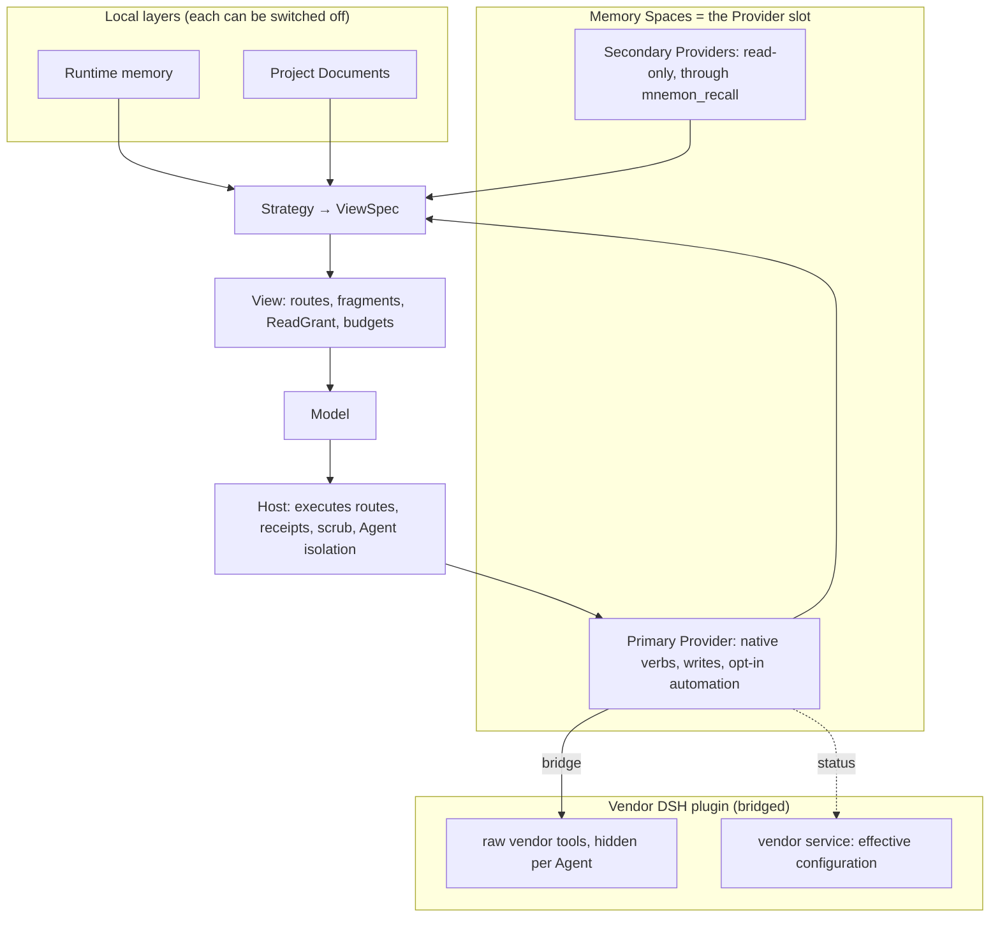

# Memory Provider strategy

## Aim

Memory Spaces can run nine Providers at once. Every Provider's capabilities are flattened into ten
shared `mnemon_*` tools, and recall ranks all of them on one score scale. Four OpenViking reports in
October 2026 come from that strategy:

- [#452](https://github.com/omdsh-dev/dsh-mnemon/issues/452): there is no exact-text search.
- [#453](https://github.com/omdsh-dev/dsh-mnemon/issues/453): images and attachments cannot be stored.
- [#454](https://github.com/omdsh-dev/dsh-mnemon/issues/454): score bands drop the right answer when scales differ.
- [#455](https://github.com/omdsh-dev/dsh-mnemon/issues/455): a write field that OpenViking 0.5 rejects breaks every write.

This plan updates the strategy:

- **One primary Provider** carries its own native verbs and the writes.
- **Vendors' DSH plugins are bridged** where they exist, as the data plane.
- **Recall stays grouped by Provider.**
- **Automation is opt-in and bounded.**

Runtime memory, Project Documents and Memory Spaces keep their roles, and so do the Sources,
Strategies and View between them. Existing features may change where the experience gets better.

## Reference: Hermes Agent

Hermes Agent also integrates these eight third-party memory providers, and it follows a different
strategy. As a mature implementation it is one of the references for this plan. The notes below come
from `NousResearch/hermes-agent` at `cb757fac59` (MIT).

How Hermes handles them:

- **One external provider beside built-in memory.** MEMORY.md and USER.md are always on, and at most
  one external provider runs beside them; `MemoryManager.add_provider` rejects a second one.
- **Native tools.** Each provider brings its own tools, such as OpenViking's `viking_search`,
  `viking_read`, `viking_browse`, `viking_remember`, `viking_forget` and `viking_add_resource`. Each
  also brings a short usage note for those tools.
- **A host-owned lifecycle.** The host runs these steps:
  - a prefetch before each turn, in the background, with an 8-second timeout;
  - a background sync after each turn;
  - extraction at session end;
  - mirroring of built-in memory writes to the provider.
- **Fenced recall.** Recall arrives wrapped and marked as recalled, not as user input, and the user
  sees a line naming what was used.
- **Isolation and egress.** Delegated subagents get no provider session, and everything sent to a
  provider passes a secret scrub first.
- **Setup.** Setup is one picker that asks only for required fields, and status lists what is
  missing.
- **Maintainers own the providers.** Providers live in their maintainers' repositories. The
  provider's name, settings and tool names are kept as the contract with users.

How it compares:

- **The strategies differ.**
  - Hermes makes the external provider the memory backend and runs it automatically every turn.
  - Mnemon composes Runtime memory, Project Documents and Memory Spaces through a View. It keeps
    several discovered spaces per Provider and reports a write only after the exact text reads back.
    Recall is tool-driven by default, so prefetch and sync are opt-in.
  - Hermes providers are packages written for Hermes. Mnemon bridges the DSH plugins vendors already
    publish.
- **Some decisions coincide.** One primary Provider at a time, Provider-native tools under the names
  users know, no Provider session for delegated Agents, and a scrub of what leaves the machine. These
  are made here for the reasons in the Aim: #452–#455 and the lab's costs. They are not made to
  match Hermes.

## Decisions (2026-10-23)

1. **One primary Provider, read-only secondaries.** One Provider holds the native verbs, the writes and
   any automation. Other Providers can stay connected for read-only recall.
2. **Familiar tool names.** Native verbs keep the names users know from these vendors' integrations
   (`viking_search`, …).
3. **Bridge the vendor's own DSH plugin.** Where a vendor publishes a compatible DSH plugin, it is
   the data plane, and Mnemon bridges to it rather than calling the vendor service itself.
4. **Automation off by default.** Prefetch, turn sync and mirroring are opt-in and bounded, and run
   only for the primary Agent. Recall stays tool-driven by default.

## Design

### The Provider slot

**The primary Provider.** Memory Spaces holds exactly one primary Provider per storage scope:

- its native verbs enter the View, replacing the ten generic Memory Spaces tools;
- Save to memory and the task Agents write there by default;
- opt-in automation applies only to it.

Its namespaces stay discovered spaces, and activating spaces still sets the recall scope.

**Secondary Providers.** These are optional and read-only. They are searched only through
`mnemon_recall`, in their own result blocks. They get no native verbs, no automation and no writes,
except a write the user names explicitly.

**The default.** Mnemon Native is the default primary. With no Mnemon CLI and no other Provider, the
Memory Spaces layer is off and every other layer keeps working, as the layer-robustness direction of
2026-10-08 requires.

### Native verbs

A Provider declares its native routes in the Memory Spaces Source. The Strategy chooses which routes
the View shows, Core validates them, and the Host runs them under the View's ReadGrant and returns
Source receipts.

Each route has a compact schema, and one Provider's routes stay under about 6 KB. For reference, the
ten generic Memory Spaces tools measure 8,640 bytes, and OpenViking's raw MCP tools 15,261 bytes on
server v0.4.21.

| Provider | Routes | Data plane |
|---|---|---|
| OpenViking | `viking_search`, `viking_read`, `viking_browse`, `viking_remember`, `viking_forget`, `viking_add_resource`, plus `viking_grep` | Bridged vendor plugin; Mnemon's adapter as fallback |
| Mem0 | `mem0_search`, `mem0_add`, `mem0_update`, `mem0_delete` | Bridge candidate for search and add; the adapter for update and delete |
| Honcho | `honcho_profile`, `honcho_search`, `honcho_context`, `honcho_reasoning`, `honcho_conclude` | Adapter: the vendor plugin's peers stop at DSH 0.2.0-rc.1 |
| Hindsight | `hindsight_retain`, `hindsight_recall`, `hindsight_reflect` | Adapter |
| Holographic | `fact_store`, `fact_feedback` | Adapter |
| RetainDB, ByteRover, Supermemory | the names their integrations use | Adapter |
| Mnemon Native | today's recall, related, link and graph verbs | Native CLI |

### Bridged Providers

A bridge uses the vendor's published DSH plugin for all I/O, so the vendor keeps its connection,
authentication and server-version handling. The vendor's own tools and skill stay out of the model's
view, and the user configures and inspects everything in one place.

A spike on 2026-10-23 proved every mechanism below with public DSH APIs. It ran on DSH 0.2.1-rc.2
with `@openviking/dsh-memory-plugin@0.5.29` and OpenViking v0.4.21.

1. **Routes.** `viking_search` runs
   `ctx.tools.execute({ callId, name: 'mcp__openviking__find', arguments, signal })` without
   `agent`. Execution resolves in the global view, so the raw tool runs even though it is hidden
   from the Agent.
2. **Hiding.** The vendor mounts its MCP tools whatever `mcpEnabled` says, because 0.5.29 never reads
   that key. They are therefore denied per Agent:
   - on `agent/created`, `agent.ctx.inject(['tools', 'skills'], scoped => scoped.tools.restrict({ deny }))`
     denies every registered `mcp__openviking__*` tool;
   - the same runs again, coalesced, on `tools/change`, because the MCP bridge registers its tools
     after the Agent starts;
   - names are recorded before `restrict` runs. `restrict` announces `tools/change` itself, and the
     spike hung in a CPU-bound loop until it recorded first.
3. **Skill shadowing.** The vendor's `openviking-memory` skill names the raw tools. An Agent-scoped
   runtime skill with the same name replaces it, because scoped layers win over the global layer.
   A runtime skill needs a `source`: without one, loading it fails with `source must be a string`.
4. **Effective configuration.** The vendor service `openvikingMemory` exposes its resolved
   configuration, and Status reads only its non-secret fields: `autoRecall`, `autoCapture`,
   `skipSubagentSessions`, endpoint, account and user.

   The Host writes the vendor entry's configuration with DSH's `configEditor`, as it already does for
   Mnemon's own entries: tools only, with subagent sessions skipped. A `plugin` section in the user's
   `~/.openviking/ovcli.conf` outranks that host input, so Status compares the effective values with
   the intended ones and says which file wins.

Writes through a bridge keep Mnemon's receipts:

- `viking_remember` runs the raw `write` with `mode: create` and `wait: true`;
- it parses the server's answer ("Wrote N bytes to `<uri>` … `vector=<state>`");
- it reads the file back through the raw `read`;
- it returns a Source receipt whose id is the URI.

The Content page, Direct search, Status and a new Resources view read through the same raw tools, so
Mnemon never holds the vendor's credentials.

Each bridge is described in data:

- the vendor package and its version range, and the DSH range;
- the raw-tool mapping and argument shaping;
- the configuration keys for tools only;
- the skills to shadow;
- the service fields Status reads;
- how namespaces map to spaces.

When the vendor plugin is missing or outside its range, the Provider falls back to Mnemon's adapter,
which serves the same route names it can honour.

### Recall grouped by Provider

Results stay in their Provider's own order, one fenced and deduplicated block per Provider, each
naming its Provider.

Score bands are removed for Providers whose scores are not calibrated (#454). Ranking then rests on
the Provider's own rank and the Agent's own judgment, plus Jev's yes/rank signals in simple mode.

A short line in the conversation shows which spaces were used, such as "Memory used: Lab machines
(OpenViking) · 3".

### Automation

| Behavior | Place in Mnemon | Default | Bound |
|---|---|---|---|
| A Provider's usage note | A Provider fact rendered in a Strategy slot | on | fixed length |
| An overview at session start | "Start with a Provider overview" enhancement | off | once per session, character budget |
| A prefetch each turn | "Prefetch each turn" enhancement, run by the Host | off | timeout, character budget, cadence |
| A sync of the conversation | "Sync the conversation to the Provider" enhancement, in the background after the scrub | off | one per turn, primary Agent only |
| Mirroring of Runtime memory writes | Runtime memory receipts mirrored to the primary Provider, deterministically, with no LLM | off | one per write |
| Task Agent isolation | Task Agents never get a Provider session or trigger capture | enforced | — |

Sync stays off by default. On 2026-10-23, OpenViking's server-side extraction rewrote a saved
preference from Chinese to English after an unrelated resource upload. It also turned plain
questions and answers into new memories.

Turning sync on also turns on a Provider Changes view. It reads `memory_diff.json` for OpenViking and
the history API for Mem0, and offers undo where the Provider allows it.

### Setup and status

- **The status line.** The Status page opens with one line: "Memory Provider: OpenViking ✓
  available · 3 spaces", and a gear beside it.
- **The picker.** The gear opens a single-choice list whose first entry is "Mnemon Native (default)".
- **Choosing a Provider.** Only the required fields are asked for. Secrets are masked, with a link to
  where they come from. OpenViking can reuse `~/.openviking/ovcli.conf`.
- **Bridged Providers.** The same flow offers to install the vendor plugin through Mnemon's existing
  plugin installation, then writes the tools-only configuration.
- **Importing settings.** An existing setup in another agent's configuration, such as `~/.hermes`,
  can be imported after the user confirms.
- **Finishing.** Spaces are discovered, and the status line turns to ✓ or names what is missing.
- **Secondaries.** They sit in an "Additional Providers (read-only)" block, off until switched on.

### Migration

No data moves.

- On the first visit after the upgrade, a primary Provider is chosen from the existing spaces. The
  choice is automatic when only one external Provider has spaces.
- The other Providers become secondaries, and switching back is one choice.
- Smart Provider placement is removed, and new spaces are created in the primary Provider.
- Save to memory keeps its choice between a named target and an Agent decision.

## Layer invariants

| Invariant | How it holds | How it is tested |
|---|---|---|
| The layers are independent | Runtime and Documents never depend on the slot. An empty slot turns Memory Spaces off, and a full MEMORY.md archives locally | Layer-combination matrix at capacity, with no Provider and with no space |
| The View is the only door | Native verbs are Source routes. Vendor tools are hidden per Agent, and their skills are shadowed | Tool-inventory snapshot tests, plus a warning when a vendor plugin runs without the bridge |
| Per-turn cost is bounded | The primary's routes replace the generic tools. Secondaries share one route. Automation has timeouts, budgets and cadence | Request-size ceilings in tests and in the lab |
| Receipts mean stored | Writes keep exact readback. Asynchronous server-side extraction appears only in Provider Changes | Receipt tests against a real server |
| Task Agents stay isolated | No prefetch, sync, mirror or vendor session for task Agents | A server-side check that no task-Agent session exists |
| Strategies stay pure | Strategies declare budgets, and the Host runs them | Existing Strategy contract tests |
| Data stays within its boundary | Pack and Git sync still carry only official components | Existing Pack and sync tests |

## Expected files

- `plugins/dsh-mnemon-source-memory-spaces/src/provider-sdk.ts`: native routes, the bridge
  descriptor and optional lifecycle facts in the Provider contract.
- `plugins/dsh-mnemon-source-memory-spaces/src/service.ts`, `source.ts`: the slot (primary and
  secondaries), recall blocks, and management operations for the slot.
- `plugins/dsh-mnemon-source-memory-spaces/src/recall-quality/policies.ts`: no score bands for
  uncalibrated Providers.
- `plugins/dsh-mnemon-source-memory-spaces/src/client/overview-page.tsx`, `provider-settings.tsx`,
  `settings.tsx`: the picker, status line, secondaries and Provider Changes.
- `plugins/dsh-mnemon-provider-openviking/src/bridge.ts` (new), `driver.ts`, `descriptor.ts`: the
  OpenViking bridge and the adapter fallback.
- `src/host/vendor-bridge.ts` (new): per-Agent hiding, skill shadowing, route execution, and vendor
  configuration through `configEditor`.
- `src/host/memory-tools.ts`, `src/host/subagent.ts`: routes in the View and in task Agents'
  allowlists.
- `plugins/dsh-mnemon-strategy-default-three-tier/src/guidance.ts`: the Provider usage-note slot.
- The opt-in automation goes into the existing enhancement mechanism. A new package is added only if
  a gate requires one.
- `docs/{en,zh-CN}/guides/memory-providers.md`, `docs/{en,zh-CN}/reference/configuration.md`.
- Tests: `tests/vendor-bridge.spec.ts`, Provider slot and recall-block tests, and the layer matrix.

## Non-goals

- A second memory engine or a rewrite of the retrieval engine. mnemon (Go) stays the engine.
- A copy of another agent's memory system.
- Calling vendor services from Mnemon where a compatible vendor DSH plugin exists.
- Bundling vendor plugins in the Starter; they are installed when the user chooses them.
- Automation on by default, or for any Agent other than the primary one.
- Changing what Pack and Git sync carry.
- Supporting several primary Providers.

## Over-engineering risk

Rules:

- Each step must close a reported problem or a measured gap before the next one starts.
- Bridges are data, one per vendor. A shared helper is written only when a second vendor needs it.
- The adapter fallback serves only the routes it already serves; it gets no new features without a
  report.

Warning signals:

- a general plugin-proxy layer;
- a registry of bridges with more than one level of indirection;
- schema translation beyond renaming and narrowing arguments;
- re-implementing a vendor feature that its plugin already provides.

Complexity budget:

| Part | Budget |
|---|---|
| Bridge runtime (`src/host/vendor-bridge.ts`) | about 300 lines |
| One bridge descriptor | about 150 lines |
| Slot and recall blocks in Memory Spaces | about 400 lines changed |
| UI | about 600 lines |

Exceeding any of these by half means stopping to ask.

## Stop and ask

- Hiding or shadowing needs a DSH change, or does not work on DSH 0.2.0-rc.2.
- A vendor plugin cannot be held to tools only, because its automation cannot be turned off.
- Recall blocks lose accuracy against today's federated recall (non-inferiority −2 points).
- Bridged turns cost more than 1.25× the adapter's on the same questions.
- A migration step would move, rewrite or delete existing memory.

## Build order and gates

0. **Adapter fixes that change no behavior.** These ship first, one pull request each:
   - #455: OpenViking writes carry only the fields every server release declares;
   - #452: keyword search gains an exact-text channel through `/api/v1/search/grep`;
   - #454: scores a Provider does not calibrate get no bands.

   Gate: each fix is proven on a real server or a contract test, and every untouched route stays
   byte-identical.
1. **The bridge runtime and the OpenViking bridge,** behind an off-by-default switch.
   Gate:
   - spike parity on DSH 0.2.1-rc.2 and 0.2.0-rc.2;
   - the same answers as the adapter on the lab questions, at ≤ 1.25× the cost;
   - no `mcp__openviking__*` tool visible to any Agent;
   - no task-Agent session on the server.
2. **The Provider slot and recall blocks.** Gate: the layer matrix passes; the #454 case is answered
   correctly with OpenViking plus Hindsight; non-inferiority holds on the lab set.
3. **Setup, status and migration in the WebUI.** Gate: before-and-after recordings, a count of the
   first-run steps for OpenViking, and updated copy and presentation baselines.
4. **Automation enhancements:** overview, prefetch, sync, mirror and Provider Changes. Gate: each is
   off by default, per-turn cost stays within its bound, and extraction-driven rewrites are shown
   and can be undone.
5. **More bridges.** Mem0 comes next, then Honcho once its plugin accepts current DSH releases. Each
   has its own gate from step 1.

## Progress

- [x] Research: how other agents handle third-party memory providers (Hermes Agent)
- [x] Lab: the official OpenViking plugin beside dsh-mnemon (coexistence, side effects, costs)
- [x] Spike: compact routes over the vendor plugin, per-Agent hiding, skill shadowing, effective configuration
- [ ] 0. #455 adapter fix
- [ ] 0. #452 adapter fix
- [ ] 0. #454 adapter fix
- [ ] 1. Bridge runtime and the OpenViking bridge
- [ ] 2. Provider slot and recall blocks
- [ ] 3. Setup, status and migration
- [ ] 4. Automation enhancements
- [ ] 5. Mem0 bridge

## Evidence

The lab ran on 2026-10-23: DSH 0.2.1-rc.2 headless with real DeepSeek turns, OpenViking v0.4.21 with
synthetic data, and request bodies recorded on loopback.

| Question set | Mnemon's adapter | Vendor tools exposed raw | Bridged, compact routes |
|---|---:|---:|---:|
| Find Docker Engine 29.8.137 among 200 near-identical hosts (input tokens) | 46,111 | 141,584 | 49,266 |
| OpenViking tool schemas per request (bytes) | — | 15,261 (15 tools) | 916 (3 routes) |
| Correct answers | all | all | all |

With the vendor plugin's defaults, which recall and capture automatically:

- the Q1–Q3 questions cost 3.4× the adapter's tokens;
- one answer came in English, because a rewritten preference was recalled;
- every short session was committed for extraction, task Agents included.

The tools-only configuration, with subagent sessions skipped, captured nothing.
